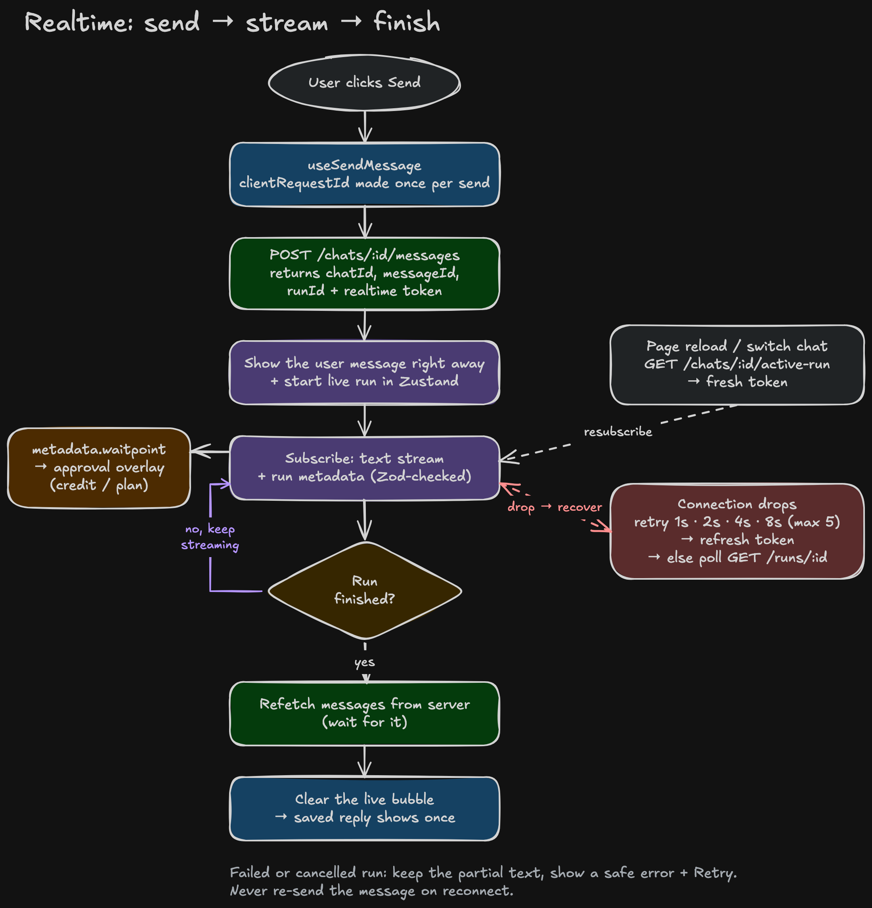

# Agent Chat — Frontend

Frontend for the Agent Chat clone (Magica / Galaxy work trial). Backend lives in a separate repo.

It's a close copy of Galaxy's live Agent Chat: you chat with an AI agent that can work for minutes, use tools (crop images, generate images, merge videos), ask you for approval, and stream its progress live. Close the tab or lose the connection, and the run is still there when you come back.

> **Status:** work in progress. Done so far: project setup, Clerk sign-in with protected routes, app shell (sidebar, composer), the API layer (`services/`, `queries/`) wired to real chats and messages. Full checklist in [`docs/REQUIREMENTS.md`](docs/REQUIREMENTS.md).

---

## Tech stack

| Area | What we use |
|---|---|
| Framework | Next.js 16 App Router + React 19 |
| Language | TypeScript (strict) |
| Auth | Clerk |
| Server data | TanStack Query |
| Live + UI state | Zustand |
| Validation | Zod (schemas copied from the backend) |
| UI | shadcn/ui + Tailwind CSS v4 |
| Realtime | Trigger.dev Realtime |
| Uploads | Uppy + Transloadit (tus) |
| Tests | Vitest + React Testing Library + MSW, Playwright |
| Package manager | pnpm |

---

## Setup

You need Node 22+, pnpm, and the backend running (see the backend README).

**1. Install**
```bash
pnpm install
```

**2. Env**
```bash
cp .env.example .env
```

| Key | Where to get it |
|---|---|
| `NEXT_PUBLIC_API_URL` | backend URL, `http://localhost:4000` locally |
| `NEXT_PUBLIC_CLERK_PUBLISHABLE_KEY` | Clerk dashboard → API keys (same Clerk app as the backend) |
| `CLERK_SECRET_KEY` | Clerk dashboard → API keys |

**3. Copy the contracts from the backend**
```bash
pnpm sync:contracts
```
This copies the Zod schemas from `../server/src/contracts` into `src/contracts`, so both sides use exactly the same shapes. Run it again whenever the backend changes a contract.

**4. Run**
```bash
pnpm dev
```
Open http://localhost:3000 — you'll be sent to sign in first.

**5. Checks**
```bash
pnpm typecheck
pnpm lint
pnpm test
```

---

## Scripts

| Script | What it does |
|---|---|
| `pnpm dev` | dev server on port 3000 |
| `pnpm typecheck` | TypeScript check |
| `pnpm lint` | ESLint |
| `pnpm test` | Vitest unit and component tests |
| `pnpm test:e2e` | Playwright end-to-end tests |
| `pnpm sync:contracts` | copy backend Zod schemas into `src/contracts` (`--check` fails if the copy is out of date) |

---

## Project structure

```
src/
  app/            routes: / , /chat/[chatId], /sign-in, /sign-up
  contracts/      generated copy of the backend's Zod schemas — never edit by hand
  services/       typed API calls — the only place that calls fetch
  queries/        TanStack Query hooks (useChats, useMessages, ...)
  stores/         Zustand: ui.store (sidebar, drawer)
  components/     shell, composer, chat, ui
  lib/            small shared helpers
  proxy.ts        Clerk route protection (Next 16 name for middleware)
scripts/          sync-contracts.ts
tests/            Vitest tests
docs/             architecture and design docs
```

Folders like `realtime/`, `stores/live-run.store.ts` and `stores/composer.store.ts` are added when the feature that needs them is built — no empty placeholder files. The planned layout is in [`AGENTS.md`](AGENTS.md).

---

## Architecture overview


Three simple rules:
1. **Saved data comes from the server through TanStack Query.** Chats, messages, balance — cached, paginated, refetched on reconnect.
2. **Live data goes into Zustand.** Streaming text, the current step, tool states and approvals come from Trigger.dev Realtime.
3. **The server copy is the final truth.** When a run finishes, we refetch the saved messages first and only then clear the live bubble, so a reply never shows twice.

**What happens when you send a message:**



More detail:
- [`docs/ARCHITECTURE.md`](docs/ARCHITECTURE.md) — pages, API layer, stores, message rendering
- [`docs/REALTIME.md`](docs/REALTIME.md) — streaming, reconnect, reload recovery, approvals
- [`docs/UI-FIDELITY.md`](docs/UI-FIDELITY.md) — how we match the live product

---

## Design decisions and trade-offs

Only decisions that are already in the code. This table grows as features are built — the full plan is in [`docs/DECISIONS.md`](docs/DECISIONS.md).

| Decision | Why | Trade-off |
|---|---|---|
| Separate frontend repo, Next.js App Router | Trial asks for two repos; the backend owns all business rules | Two deploys, CORS on the backend |
| Contracts copied from the backend by a script, not hand-written | One source of truth for every shape; the copy is committed so the Vercel build works on its own | Need to re-run `pnpm sync:contracts` after backend changes (`--check` catches a stale copy) |
| Clerk protects every route except sign-in / sign-up, in `proxy.ts` | One place for auth rules instead of checks scattered in pages | — |
| TypeScript pinned to the same version as the backend | Shared Zod contracts compile the same way on both sides | Upgrades must happen in both repos together |
| All API calls go through `services/*`, via one `request()` in `api-client.ts` | No raw `fetch` in components; one place adds the Clerk token, parses the response with Zod, and maps errors to `ApiError` | Every new route needs a service function, even trivial ones |
| TanStack Query for chats and messages, cursor-paginated with `useInfiniteQuery` | Matches the backend's cursor pagination; caching and refetch come for free | Optimistic chat-list updates (rename/pin/delete) need manual cache patching + rollback |
| `clientRequestId` generated once per send and reused on retry (`useRef`, not component state) | A retried send must hit the backend with the same id so it can't create a duplicate turn | The id only resets after a successful send, so a failed send must be retried, not re-typed, to stay idempotent |
