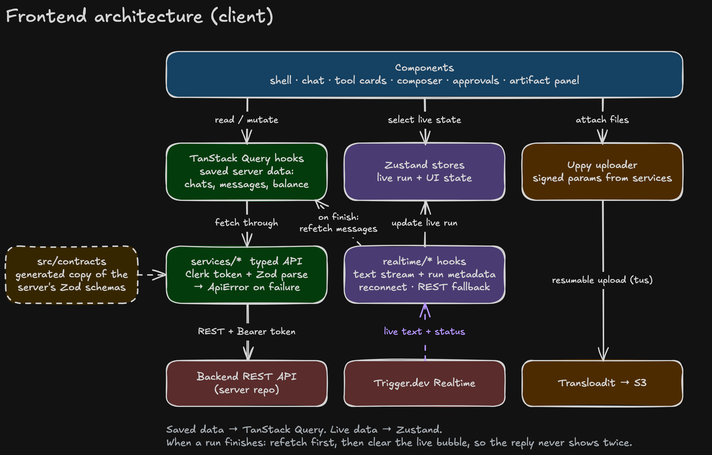

# Frontend Architecture

## 1. Big picture



Simple rule:
- **What's saved on server** → TanStack Query.
- **What's happening live right now** → Zustand (fed by realtime).
- **When live finishes** → refetch from server, clear live state. Server copy is the final truth.

## 2. Pages

| Route | What |
|---|---|
| `/` | empty state + composer (new chat created on first send) |
| `/chat/[chatId]` | chat view: messages + composer + optional artifact panel |
| `/sign-in`, `/sign-up` | Clerk |

Layout: persistent sidebar (chat list, search, pinned), main chat area, artifact panel on the right (opens when a generated image/video is clicked). Mobile: sidebar becomes a drawer, same controls.

## 3. API layer

```
services/api-client.ts   → request<T>(path, { schema, method, body })
                           - adds Authorization: Bearer <clerk token>
                           - parses JSON with the Zod schema (bad shape = clear error)
                           - maps { error: { code, message } } to ApiError
services/chats.service.ts, messages.service.ts, runs.service.ts,
        uploads.service.ts, credits.service.ts, waitpoints.service.ts
```

Query hooks (`queries/`):
- `useChats({ q })` → `useInfiniteQuery`, cursor pagination
- `useMessages(chatId)` → `useInfiniteQuery`, newest first, load older on scroll up
- `useSendMessage()` → mutation, generates `clientRequestId` (uuid) **once per send** so retries are idempotent
- `useActiveRun(chatId)`, `useRun(runId)` (REST fallback), `useMe()` (balance)
- `useCancelRun()`, `useRetryRun()`, `useRespondWaitpoint()`, `usePinChat()`, `useDeleteChat()`, `useRenameChat()`

Query keys in one file (`queries/keys.ts`) so invalidation is consistent.

## 4. Stores (Zustand)

`stores/live-run.store.ts` — keyed by `runId`:
```ts
{ runId, chatId, status, text, thinkingStartedAt, currentStep,
  tools: ToolState[], assets: Asset[], waitpoint?: Waitpoint, error?: SafeError,
  connection: "live" | "reconnecting" | "polling" }
```

`stores/ui.store.ts` — sidebar open, artifact panel (which asset), mobile drawer.

`stores/composer.store.ts` — draft text per chat, plan mode toggle, attachments in progress (with order, progress, status).

## 5. Message rendering

```
MessageList (virtualized, @tanstack/react-virtual)
  ├─ saved messages (from query)
  └─ LiveAssistantBubble (from live-run store, only while a run is active)

Message
  └─ blocks.map(block => <BlockRenderer block={block} />)
        text       → markdown
        thinking   → collapsible "Thought for 12s"
        tool_use   → ToolCard (renderer by renderKey)
        tool_result→ merged into its ToolCard
        reasoning, citations, usage → small components
```

States are visually different: streaming, complete, failed (red + Retry), cancelled ("Stopped" + Retry).

## 6. Tool renderer registry

```ts
// components/tools/registry.ts
export const toolRenderers: Record<string, ToolRenderer> = {
  "image-result": ImageResultCard,
  "video-result": VideoResultCard,
  "skill-load": SkillLoadCard,
  "model-info": ModelInfoCard,
};
// unknown renderKey → GenericToolCard
```

Each card shows: label, status (pending/running/done/failed/cancelled), duration, credits, sanitized input/output on expand, and user-safe error.


## 7. Uploads

Uppy with Transloadit plugin + tus. Flow:
1. user picks files → validate type/size/count on client (same limits from contracts)
2. `POST /uploads/sign` → signed params + attachment ids
3. Uppy uploads with progress, cancel, retry, optimistic preview
4. attachments keep their order; send is allowed when all are `ready`

